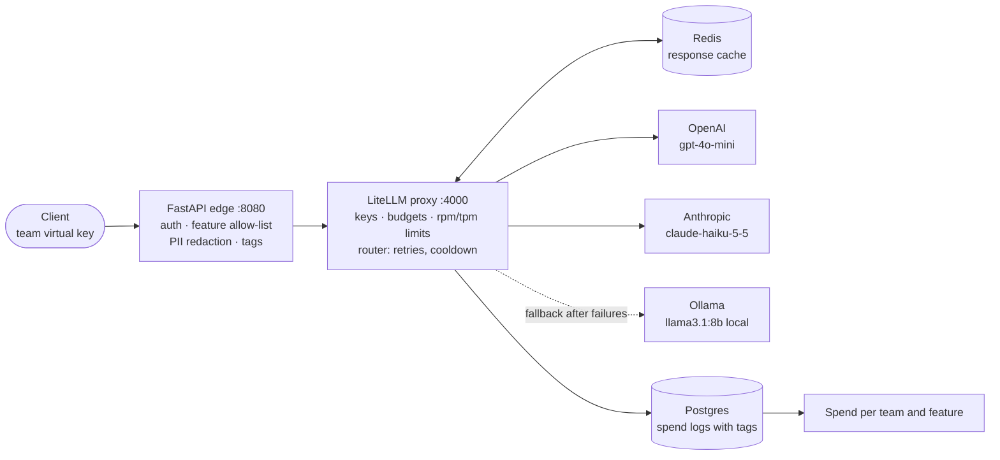

# LiteLLM Gateway: Failover and Spend Attribution

One OpenAI-compatible endpoint in front of OpenAI, Anthropic and a local Ollama model. It has per-team virtual keys and budgets, retries with failover to the local model, response caching and per-team, per-feature spend attribution. A small FastAPI edge in front of [LiteLLM](https://github.com/BerriAI/litellm) adds custom auth, PII redaction and request tagging.


> **Status: tested in parts, stack not yet run.** The edge service (PII redaction, budget error mapping) has 4 passing unit tests. The full stack (Docker Compose, LiteLLM, Postgres, Redis, real providers) and the three evaluation scripts have not been run, so this README reports **no latency, throughput, recovery-time or cost numbers**. See [Status and findings](#status-and-findings).

## Architecture



A picture version is in `docs/architecture.svg`.

**Request path**

1. The client sends `POST /v1/chat/completions` with its team's virtual key and an optional `x-feature` header.
2. The edge resolves the key to a team through LiteLLM `/key/info` (`401` if missing or invalid), checks the feature allow-list (`403`), rejects `stream=true` (`400`), redacts PII in the messages, and adds `team:` and `feature:` tags.
3. LiteLLM enforces the budget and the rpm/tpm limits, checks the Redis cache (10 minute TTL), then routes: weighted shuffle across providers, 2 retries, a 15 second cooldown after 2 failures, and a fallback to the local model.
4. Spend is written to Postgres with the tags, so cost can be attributed per team and per feature.
5. An exhausted budget returns `429 {"error":{"type":"budget_exceeded"}}` instead of LiteLLM's raw `400`.

**Teams** created by `make keys` (`src/gateway/keys.py`): `search` ($50 per 30 days, 300 rpm), `support-bot` ($20 per 30 days, 100 rpm) and `sandbox` ($1 per day, 10 rpm).

## Quickstart

```bash
cp .env.example .env         # add provider keys; change the placeholder passwords
make run                     # edge :8080, litellm :4000, postgres, redis (docker compose)
make keys                    # prints one virtual key per team, shown once
curl localhost:8080/v1/chat/completions -H "Authorization: Bearer $KEY" -H "x-feature: faq" \
  -d '{"model":"chat","messages":[{"role":"user","content":"hi, mail me at a@b.com"}]}'
make test                    # unit tests, no network
```

Local Ollama (`llama3.1:8b`) must be reachable at `host.docker.internal:11434` for the fallback to work.

## Evaluation design

| Script | What it measures |
|---|---|
| `make eval` runs `eval/loadtest.py` | 2,000 requests at concurrency 50, three paths: direct to LiteLLM, through the edge, and through the edge on a cache hit. Reports requests per second, p50, p95, error rate and the added p95 from the edge. |
| `make eval` also runs `eval/spend.py` | Per team: cost logged by LiteLLM vs a recompute from logged token counts and a price table. Provider invoices are the real ground truth; fill `INVOICE_USD` to compare. |
| `make failover KILL_CMD="..."` runs `eval/failover.py` | Sends 1 request per second for 60 seconds, runs your `KILL_CMD` at 15 seconds to simulate a provider outage, and reports failed or slow requests (over 3 seconds) and the recovery time. |

`eval/loadtest.py` and `eval/failover.py` need an `EVAL_KEY` (a virtual key from `make keys`). Results are written to `eval/results/<name>_<timestamp>.json`. `KILL_CMD` is run through a shell, so set it yourself and never from untrusted input.

## Results

**Not measured yet.** Run the stack and the three scripts, then commit the files from `eval/results/`. The prices in `eval/spend.py` are placeholders: check the providers' pricing pages first.

## Status and findings

Checked on 2026-10-30:

- **Tests:** 4 unit tests pass (PII redaction of email, IBAN, card and phone; redaction in message parts; budget error mapped to `429`; other errors passed through). `ruff check` passes.
- **Fixed while preparing this repository:** the failover drill ran a blocking `subprocess.run` inside an async function. It now uses `asyncio.to_thread`. `.env.example` now contains only placeholders, and a `.gitignore` was added.
- **Not run:** the Docker stack, the providers, the three evaluation scripts, the Ollama fallback. Nothing here proves the failover or the budget handling against a real LiteLLM instance.
- **Unverified:** the LiteLLM image tag (`main-stable`) is not pinned to a digest, and the model identifiers in `litellm_config.yaml` and the prices in `eval/spend.py` should be checked against the providers before use.

## Trade-offs and limits

- **Edge in front, not a LiteLLM callback.** Easy to test and swap, at the cost of one extra hop. A LiteLLM custom guardrail would be zero-hop but ties the logic to LiteLLM internals.
- **Regex PII redaction** is fast and dependency-free but misses names and addresses. Use Presidio if recall matters.
- **No streaming at the edge yet:** `stream=true` returns `400`.
- **The team cache has no TTL.** Restart the edge after rotating a key.
- **Exact-match cache only.** Semantic caching would raise the hit rate and add the risk of wrong hits.

## Layout

```
src/gateway/          app.py (edge) · pii.py · keys.py (teams, keys, budgets)
litellm_config.yaml   providers, router, cache, database
docker-compose.yml    edge, litellm, postgres, redis
eval/                 loadtest.py · failover.py · spend.py · results/
tests/                unit tests for the edge
docs/architecture.svg
```

## Credits

[BerriAI/litellm](https://github.com/BerriAI/litellm) is used as a dependency (a container image) and is not forked. Check its licence before redistributing it. All code in this repository is original.

## License

[MIT](LICENSE)
